<p align="center">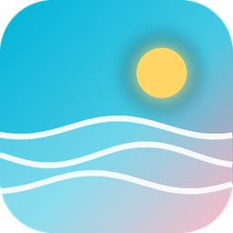</p>

<h1 align="center">Lagoona</h1>

<p align="center">Мобильное приложение для пляжного гардероба: каталог купальников, личная коллекция, список желаний и сравнение цен в магазинах.<br>Flutter, один код для Android, iOS и веба.</p>

<p align="center">
  <a href="https://silokon.github.io/lagoona-demo/"><b>Открыть демо в браузере</b></a> · лучше с телефона ·
  <a href="https://github.com/Silokon/lagoona-demo/releases/latest"><b>Скачать APK для Android</b></a>
</p>

<p align="center">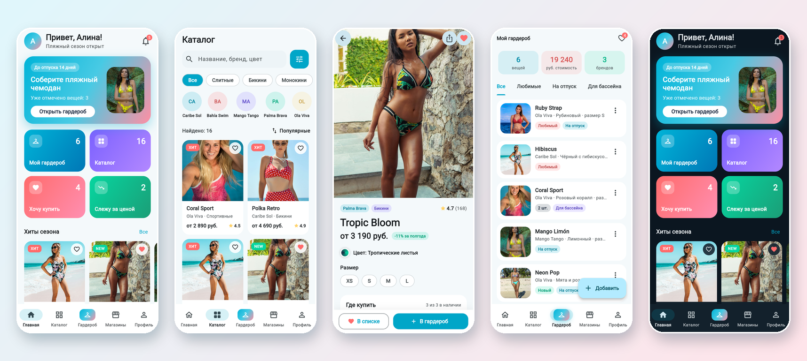</p>

## Экраны

| Приветствие | Вход | Каталог | Фильтры |
|---|---|---|---|
| 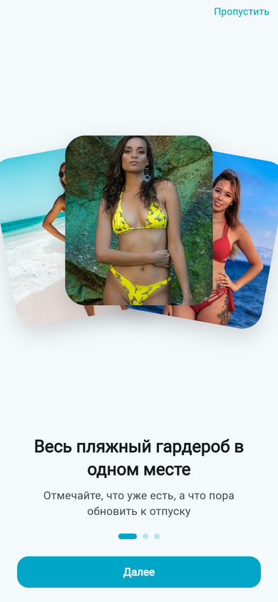 | 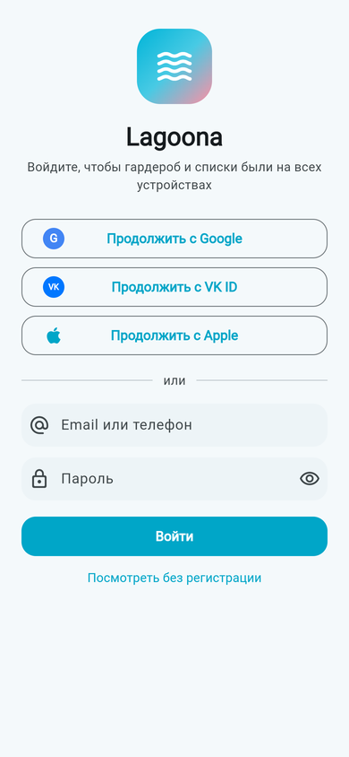 | 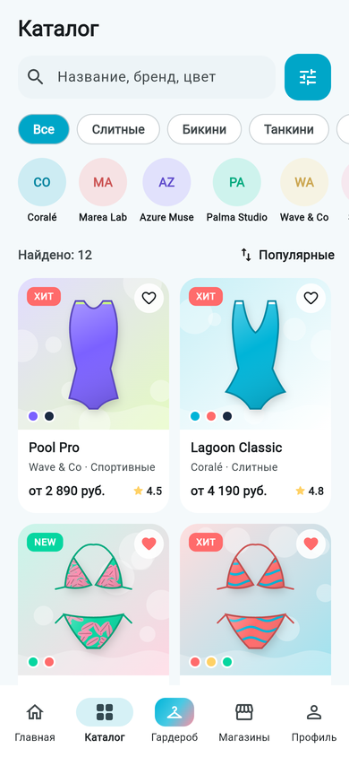 | 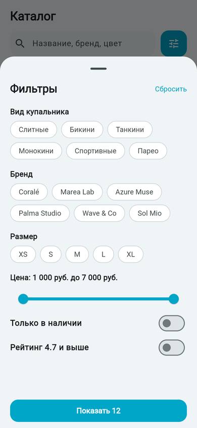 |
| **Карточка товара** | **Добавить вручную** | **Хочу купить** | **Магазины** |
| 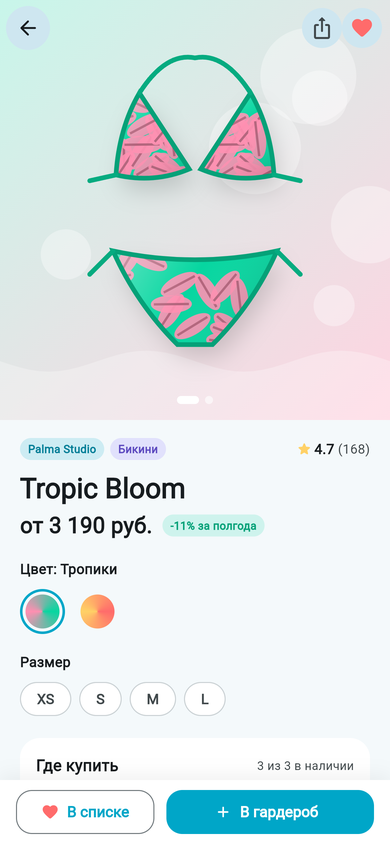 | 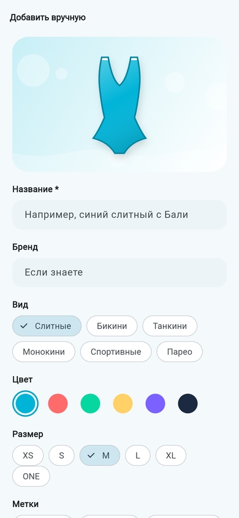 | 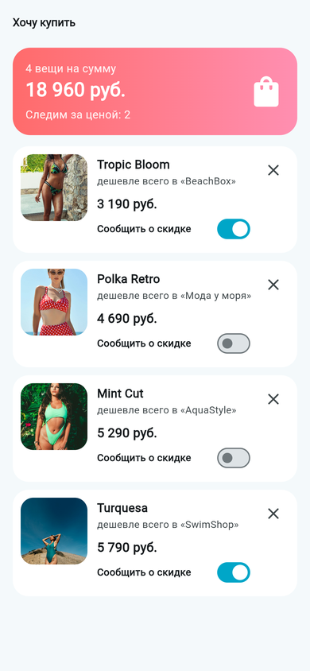 | 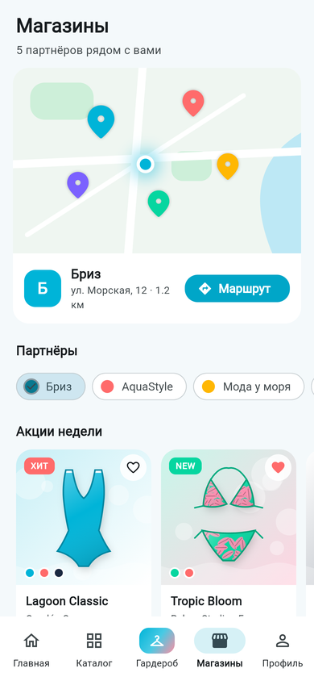 |
| **Уведомления** | **Профиль** | **Тёмная тема** | **Гардероб, тёмная** |
| 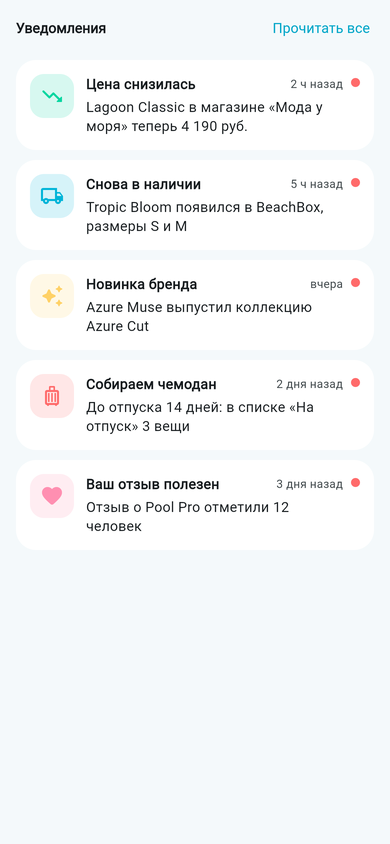 | 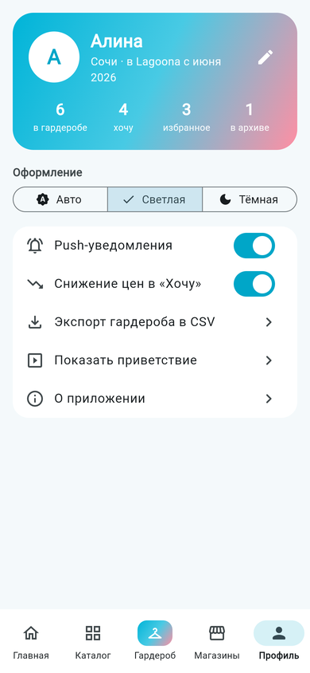 | 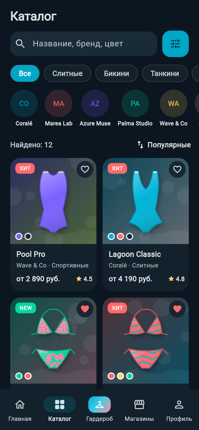 | 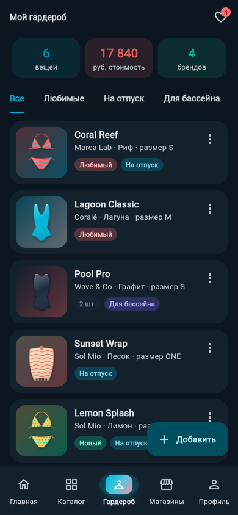 |

## Что умеет

- **Каталог.** Поиск по названию, бренду и цвету, быстрые категории, фильтры по виду, бренду, размеру, цене, наличию и рейтингу, сортировка.
- **Карточка товара.** Галерея расцветок со свайпом, выбор цвета и размера, сравнение цен в магазинах с лучшей ценой, график истории цены, характеристики и отзывы.
- **Мой гардероб.** Вкладки «Любимые», «На отпуск», «Для бассейна», «Архив». Количество, размер, метки и заметки к каждой вещи, добавление из каталога или вручную с живым превью, архив, экспорт в CSV.
- **Хочу купить.** Список желаний с суммой, лучшей ценой и уведомлением о снижении цены для каждой позиции.
- **Магазины.** Карта партнёров рядом, акции недели, сравнение цен по всему списку «Хочу».
- **Уведомления**, **профиль** со статистикой, **светлая и тёмная темы**, приветствие из трёх экранов и экран входа (Google, VK ID, Apple).

Данные гардероба и списков сохраняются на устройстве между запусками.

## Стек и устройство

| | |
|---|---|
| UI | Flutter 3.47, Material 3, своя тема и палитра |
| Состояние | `ChangeNotifier` + `InheritedNotifier`, без сторонних библиотек |
| Хранение | `shared_preferences`, сериализация в JSON |
| Графика | иллюстрации купальников, карта и график цены нарисованы через `CustomPainter`, без картинок и внешних API |

```
lib/
  main.dart        тема, нижнее меню, точка входа
  data.dart        модели и демо-каталог
  state.dart       состояние приложения и сохранение
  art.dart         CustomPainter: купальники, график цены, карта
  widgets.dart     карточки, строки списка, общие элементы
  screens_a.dart   главная, каталог с фильтрами, карточка товара
  screens_b.dart   приветствие, вход, гардероб, вишлист, магазины, уведомления, профиль
```

В реальном проекте каталог и цены приходят с backend (FastAPI или NestJS) из фидов магазинов, вход идёт через Firebase Auth или свой JWT. Интерфейс к этому готов: данные отделены от экранов.

## Запуск

```bash
flutter pub get
flutter run            # Android-устройство или эмулятор
flutter run -d chrome  # веб-версия
flutter build apk      # APK для установки
```

В веб-версии любой экран открывается ссылкой: `?screen=catalog`, `?screen=product&id=s2`, `?screen=wardrobe&theme=dark`. Веб-демо публикуется на GitHub Pages автоматически при каждом пуше в `main`.

Бренды, магазины, цены и отзывы вымышленные, это демо для портфолио.
